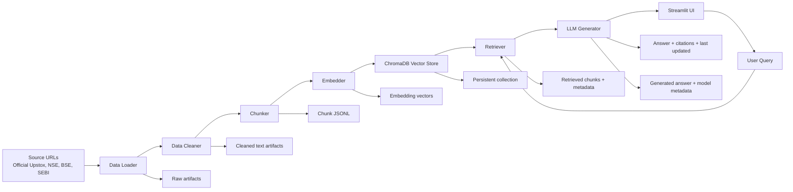

# Architecture Document

## 1. Purpose
This document defines the system architecture for the Upstox FAQ Assistant, derived from the requirements in [PRD.md](PRD.md). The solution is a transparent, fact-grounded, RAG-based chatbot that answers questions about Upstox features, charges, account processes, orders, funds, and reports using only official public sources.

## 2. Architectural Goals
- Provide concise, factual answers grounded in official public sources.
- Ensure every answer includes at least one citation and a last-updated indicator.
- Prevent unsafe financial guidance by enforcing refusal logic for investment advice.
- Keep the system modular and configurable for data, embedding, vector storage, and LLM providers.
- Produce inspectable intermediate artifacts for every stage of the RAG pipeline.
- Support local demonstration and easy extension for additional official sources.

## 3. High-Level Architecture



## 4. Core Components

### 4.1 Source Input Layer
Responsible for collecting official public data from trusted sources.

Components:
- Source URL registry
- Scraper service
- Metadata tracker
- Source validation layer

Responsibilities:
- Maintain a curated list of 15–25 official URLs
- Download only public, official pages
- Record URL, title, publication date, source type, and retrieval timestamp
- Avoid third-party blogs or private app-only content

### 4.2 Data Ingestion Layer
Responsible for preparing raw content for retrieval.

Components:
- HTML/text fetcher
- Raw content storage
- Source metadata storage

Artifacts:
- raw_html/
- raw_text/
- sources.csv or sources.md

### 4.3 Data Cleaning Layer
Responsible for removing noise and preserving only relevant content.

Components:
- HTML parser
- Content extraction logic
- Duplicate filtering
- Navigation and boilerplate removal
- Language and formatting normalization

Outputs:
- Cleaned text files
- Sanitized source sections
- Structured metadata for each cleaned document

### 4.4 Chunking Layer
Responsible for dividing cleaned content into semantically meaningful retrieval units.

Components:
- Content-aware chunking strategy
- Chunk metadata builder
- Chunk ID generator

Recommended strategy:
- Split by heading or section
- Preserve nearby context around definitions and process explanations
- Keep chunks small enough for retrieval precision and large enough for useful answers

Outputs:
- JSONL file with chunk text and metadata
- Source URL
- Chunk index
- Section heading
- Last updated information if available

### 4.5 Embedding Layer
Responsible for converting chunks into embeddings for similarity search.

Technology:
- sentence-transformers/all-MiniLM-L6-v2

Responsibilities:
- Embed each chunk
- Store vector metadata alongside source and chunk ID
- Use the same embedding model for indexing and retrieving

Outputs:
- embedding metadata
- stored vectors
- chunk-to-embedding mapping

### 4.6 Vector Database Layer
Responsible for persistence and retrieval.

Technology:
- ChromaDB

Responsibilities:
- Store chunks, embeddings, and metadata
- Support cosine-similarity retrieval
- Keep vectors queryable from user prompts
- Persist collection state for repeatable demos

Storage model:
- document_id
- source_url
- chunk_id
- text
- embedding
- section metadata
- source metadata

### 4.7 Retrieval Layer
Responsible for identifying the most relevant chunks for a user query.

Flow:
1. User enters a question
2. Query is embedded using the configured embedding model
3. ChromaDB performs similarity search
4. Top-k relevant chunks are returned with scores and source metadata
5. Retrieved context is passed to the generation step

Responsibilities:
- Relevance ranking by cosine similarity
- Filtering to official source collections only
- Returning transparent evidence lists

### 4.8 Generation Layer
Responsible for answering questions using retrieved context and safe prompting.

Technology:
- Configurable LLM provider layer over Groq, Gemini, OpenAI, Anthropic, and Mistral

Responsibilities:
- Assemble prompt with relevant retrieved chunks
- Enforce answer constraints:
  - max three sentences
  - factual only
  - each answer includes a source link
  - indicate last updated from sources
- Add a safe refusal path for investment advice requests

Output payload:
- answer text
- source links
- last updated date
- model/provider metadata
- confidence or retrieval references

### 4.9 UI Layer
Technology:
- Streamlit

Responsibilities:
- Present a responsive landing screen with branded header, welcome message, and suggested FAQ cards.
- Accept questions through the chat composer and suggested-question actions.
- Keep the conversation in Streamlit session state and render user and assistant messages.
- Pass retrieved context to the answer generator once per question.
- Render answer text, official source links, and the last-updated indicator together.
- Display a persistent facts-only disclaimer and handle refusal or no-result answers without inventing citations.

Interaction states:
- Landing: category prompts for brokerage, funds, orders, and reports.
- Conversation: user question, grounded answer, source cards, and a new-conversation action.
- Responsive layout: prompt cards and conversation content adapt to narrow mobile viewports.

UI text requirements:
- Product title: “Upstox FAQ Assistant”
- Landing headline: “How can we help you today?”
- Disclaimer: “Facts-only. No investment or trading advice.”

### 4.10 Evaluation Layer
Responsible for measuring retrieval quality and answer correctness.

Components:
- Test query set
- Expected answer reference file
- Retrieval evaluation metrics
- Citation validation
- Refusal behavior checks

Metrics:
- retrieval relevance score
- factual correctness
- citation completeness
- refusal correctness for non-permitted requests
- source freshness and traceability

## 5. End-to-End Data Flow

### 5.1 Ingestion Flow
1. Source URLs are curated and stored.
2. Scraping fetches raw HTML/text.
3. Metadata such as title, URL, retrieved date, and source class are saved.
4. Raw files are archived for inspection.

### 5.2 Cleaning Flow
1. Navigation, duplicates, and boilerplate are removed.
2. Structured content is extracted into cleaned text files.
3. Sanitized pages are prepared for chunking.

### 5.3 Chunking and Embedding Flow
1. Cleaned text is segmented into chunks.
2. Chunk metadata is created.
3. Chunks are converted into embeddings.
4. Embeddings and metadata are stored in ChromaDB.

### 5.4 Query Flow
1. User asks a question.
2. Question is embedded using the same model.
3. Similar chunks are retrieved.
4. Relevant text is passed to the LLM.
5. LLM produces a brief factual response with citations.
6. Streamlit renders the question and answer, links each displayed citation to its official source, and shows the last-updated text.
7. Conversation state remains available for the current browser session; starting a new conversation clears it.

## 6. Security and Safety Architecture

### 6.1 Privacy Protection
- No PAN, Aadhaar, OTP, phone numbers, email addresses, account numbers, or passwords are accepted.
- Forms and chat handling do not request sensitive data.
- The system only works with public content and user questions.

### 6.2 Financial Advice Guardrails
- Prompting layer blocks investment advice requests.
- Refusal templates are used when a user asks for buy/sell recommendations or predictions.
- The assistant answers only factual platform process and feature questions.

### 6.3 Source Trust Boundaries
- All retrieved content must be mapped to official sources.
- Answers cannot claim facts unsupported by indexed official sources.
- If information is missing from the collection, the system must state so clearly.

## 7. Configuration Architecture
To satisfy the configurable technology requirement, the system should use a central configuration layer based on environment variables.

Example configuration categories:
- LLM provider
- LLM model name
- API key values
- Embedding model name
- Vector DB collection name
- ChromaDB path
- Retrieval K value
- Chunk size and overlap
- Source file paths

Recommended configuration file:
- .env
- config.yaml or settings.py

Example configuration entries:
- EMBEDDING_MODEL=sentence-transformers/all-MiniLM-L6-v2
- VECTOR_DB=chromadb
- DEFAULT_LLM_PROVIDER=groq
- DEFAULT_MODEL=qwen/qwen3.8-27b

## 8. Component Interaction Model

### 8.1 Modules
- source_manager.py
- scraper.py
- cleaner.py
- chunker.py
- embedder.py
- vector_store.py
- retriever.py
- llm_client.py
- prompt_builder.py
- app.py
- evaluator.py

### 8.2 Responsibilities by Module
| Module | Responsibility |
| --- | --- |
| source_manager.py | Stores source list and source metadata |
| scraper.py | Downloads public content |
| cleaner.py | Removes noise and normalizes text |
| chunker.py | Creates semantically relevant chunk units |
| embedder.py | Converts chunks into vector embeddings |
| vector_store.py | Persists and queries embeddings |
| retriever.py | Returns relevant chunks with scores |
| llm_client.py | Wraps provider integrations |
| prompt_builder.py | Creates grounded prompts |
| app.py | Streamlit UI and orchestration |
| evaluator.py | Runs retrieval and answer validation |

## 9. Deployment Architecture
### 9.1 Local Prototype Deployment
- Local Python environment
- Streamlit app for interactive use
- ChromaDB local storage
- Local artifact folders for each RAG phase

### 9.2 Recommended Directory Structure
```text
project/
├── app/
│   ├── app.py
│   ├── config.py
│   └── ui/
├── data/
│   ├── raw/
│   ├── cleaned/
│   ├── chunks/
│   ├── embeddings/
│   └── sources/
├── vectorstore/
│   └── chroma/
├── prompts/
│   └── system_prompt.txt
├── outputs/
│   ├── retrieval_results/
│   ├── generation_results/
│   └── evaluation_results/
├── .env
├── README.md
├── PRD.md
├── architecture.md
└── requirements.txt
```

## 10. Non-Functional Requirements
### 10.1 Performance
- Retrieval should respond within a few seconds for typical FAQ questions.
- Chunking and embedding should be handled offline during data ingestion.

### 10.2 Maintainability
- Separate modules for each RAG stage
- Clear configuration and artifact outputs
- Easy provider swap without changing application logic

### 10.3 Observability
- Log retrieval scores, selected sources, and model metadata
- Keep outputs traceable for demonstration and debugging

### 10.4 Extensibility
- Add more sources without rewriting the system
- Support additional LLM providers in the provider abstraction layer
- Allow different chunking strategies through configuration

## 11. Risks and Mitigations
### Risk: Unverified source quality
Mitigation: restrict to official public sources and maintain a curated source list.

### Risk: Hallucinated answers
Mitigation: enforce grounded responses based on retrieved chunks and citations.

### Risk: Unsafe financial guidance
Mitigation: refusal layer for buy/sell recommendations and trading predictions.

### Risk: Incomplete source coverage
Mitigation: clearly state when data is unavailable in indexed sources.

## 12. Proposed Implementation Sequence
1. Setup source registry and scraper.
2. Build raw data ingestion and source metadata storage.
3. Implement cleaning and extraction.
4. Add chunking and vectorization.
5. Store and query ChromaDB.
6. Build LLM prompt and answer generation layer.
7. Create Streamlit UI.
8. Add evaluation scripts and demo outputs.
9. Validate all answer constraints and citation rules.

## 13. Acceptance Mapping to Architecture
The architecture satisfies the PRD by enabling:
- user-facing FAQ assistance via Streamlit
- official-source retrieval through a documented ingestion pipeline
- retrieval grounding via ChromaDB and embeddings
- concise, citation-based answers via the generation layer
- configurable LLM and vector providers via environment-based settings
- explicit intermediate artifact generation for each RAG phase

## 14. Summary
The proposed system is a modular RAG-based FAQ assistant with a small but robust architecture: source ingestion, cleaning, chunking, embedding, vector retrieval, language generation, and evaluation. The architecture is intentionally transparent, configurable, and safe, ensuring that the product remains grounded in official information and does not drift into financial advice or unsupported claims.
